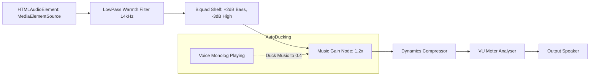

# PRD Penyiar Sunyi v2.1 — Audio Rework, Curated Music & Playback UX

**Dokumen Spesifikasi Produk**, Versi 2.1 (Addendum & Rekayasa Ulang Subsistem Audio Musik)  
**Status Proyek:** Portofolio & Proyek Kreatif Non-Komersial / Fun Project  
**Platform:** PC Desktop (Web Browser, Three.js, Web Audio API, HTML5/CSS)  
**Tujuan Dokumen:** Panduan lengkap untuk merombak total sistem musik dari synth prosedural ke pemutaran file musik asli (.mp3) durasi penuh, kurasi lagu Indonesia bertema malam/healing, sistem kontrol skip/fast-forward diegetik, dan rekayasa audio mixing.

---

## 1. Analisis Durasi: Full Lagu vs Reff Saja?

### Keputusan Desain: **Full Song (Full Durasi) + Mekanik Skip Diegetik**

**Kenapa harus Full Song?**
1. **Inti Game adalah Zen & Relaksasi:** Game ini bukan kuis atau game serba cepat (*no game-over, no rush*). Pemain memainkan game ini untuk menyendiri, memandang hujan di kaca jendela, mendengarkan lirik, dan meresapi rasa kantuk/mellow. Memotong lagu hanya di bagian reff akan merusak *build-up* emosi dan terasa seperti sound TikTok, bukan siaran radio malam yang tenang.
2. **Keleluasaan Pemain:** Pemain yang sedang ingin *deep healing* bisa membiarkan lagunya berputar penuh sampai habis sambil menyetel mixer dan melihat rintik hujan.
3. **Penyelamat Waktu (The Skip / FF Feature):** Karena 8-10 lagu penuh memakan waktu ~25-35 menit, kita wajib menyediakan mekanisme **Skip / Fast-Forward / Eject** yang terintegrasi secara natural (*diegetic*) di radio/tape player meja siaran.

---

## 2. Fitur Kontrol Playback (Mekanik Skip & Forward)

Agar tombol skip tidak merusak estetika radio analog vintage, kontrol diintegrasikan secara diegetik di konsol deck/UI:

### 2.1 Pilihan Mekanik Skip:
1. **Tombol "Fast Forward (>>)" atau "Eject / Next Track (⏭)" di Tape Deck:**
   - Berada langsung di panel tape deck meja siaran (3D object yang bisa diklik / tombol UI konsol radio).
   - Efek suara: Saat ditekan, audio melakukan **fade-out cepat (0.4 detik)** disertai SFX klik mekanik kaset (`tape_stop.wav` / `tape_click.wav`), kemudian status beralih ke:
     - Pesan balasan pendengar masuk (*incoming listener feedback*).
     - Kaset berhenti berputar (*reels stop*), siap untuk di-*eject* atau diganti.
2. **Tombol "Lompat ke Reff / Fast-Forward 30 Detik":**
   - Pemain yang tidak mau melewati seluruh lagu tapi ingin langsung ke puncak lagu bisa menekan tombol rewind/fast-forward.
3. **Hotkeys Keyboard (Opsional untuk Akses Cepat):**
   - Tombol `Space`: Play / Pause Kaset.
   - Tombol `N` atau `S`: Skip lagu saat ini (Fade-out & trigger fase berikutnya).

---

## 3. Daftar Kurasi Lagu (10 Kaset Radio "Penyiar Sunyi")

Berikut adalah 10 lagu yang diselaraskan dengan profil tiap pendengar (L1 s/d L8, Jeda Hujan, dan Penutup Subuh):

| Kaset | Judul Lagu & Artis | Genre & Vibes | Cocok untuk Karakter | Momen / Alasan Lirik |
|---|---|---|---|---|
| **K1** | **Tulus - Diri** | Pop Akustik Mellow | Rani (L1 - Lelah kantor) / Nadia (L4 - Cemas) | *"Luka, luka, hilanglah luka... Biar senyum jadi senjata. Kau terlalu berharga untuk luka... Katakan pada dirimu semua baik-baik saja."* |
| **K2** | **Hindia - Rumah ke Rumah** *(Acoustic / Live)* | Indie Folk / Mellow | Dito (L2 - Rindu rumah/ibu) | *"Pindah berkala, rumah ke rumah... Menua bersama, entah dengan siapa..."* — sangat kena untuk perantau yang kangen rumah. |
| **K3** | **Banda Neira - Sampai Jadi Debu** | Piano & String Mellow | Bu Maya (L3 - Kesepian di rumah kosong) | Dentingan piano syahdu yang menemani keheningan rumah tua di malam hari. |
| **K4** | **Nadin Amizah - Beranjak Dewasa** / **Sorai** | Folk Pop Melankolis | Fajar (L5 - Ragu masa depan) | Suara lembut khas Nadin bercerita tentang proses bertumbuh dan menerima perpisahan. |
| **K5** | **Baskara Putra / Hindia - Evaluasi** *(Acoustic)* | Lo-Fi / Acoustic | Nadia (L4) / Dimas (L7 - Insomnia) | *"Yang belum selesai, hancurkan saja... bilas muka, gosok gigi, evaluasi..."* |
| **K6** | **Ghea Indrawari - Jiwa yang Bersedih** | Ballad Piano | Karakter dalam duka / tekanan | *"Sampaikan pada jiwa yang bersedih, begitu dingin dunia yang kau huni... Menangislah, luapkan saja..."* |
| **K7** | **Danilla - Senja di Ambang Pilu** | Jazz / Bossa Mellow | Jeda Hujan (Intermission) | Karakter suara berat Danilla memberi atmosfer rokok, kopi hitam, dan malam berkabut. |
| **K8** | **Iwan Fals - Ibu** *(Acoustic Fingerstyle)* / **Fiersa Besari - Celengan Rindu** | Acoustic Ballad | Dito (L2) / Bu Maya (L3) | Melodi akustik intim yang menyentuh tema kerinduan keluarga. |
| **K9** | **Pamungkas - Monolog** atau **I Love You But I'm Letting Go** | Pop Soul Mellow | Karakter patah hati / sepi | Refleksi diri di larut malam sebelum jam 3 pagi. |
| **K10** | **Banda Neira - Matahari Pagi** | Indie Folk Akustik | Subuh (Closing Shift Siaran) | *"Hangat mentari pagi, buka mata dan tersenyumlah..."* — penutup sempurna saat langit malam berganti fajar. |

---

## 4. Struktur File & Arsitektur Teknis

### 4.1 Lokasi File
```text
Penyiar Sunyi/
├── public/
│   ├── music/
│   │   ├── k1_tulus_diri.mp3
│   │   ├── k2_feby_putri_runtuh.mp3
│   │   ├── k3_nadin_amizah_beranjak_dewasa.mp3
│   │   ├── k4_lagu_4
│   │   ├── k5_lagu_5
│   │   ├── k6_lagu_6
│   │   ├── k7_lagu_7
│   │   ├── k8_lagu_8
│   │   ├── k9_lagu_9
│   │   └── k10_lagu_10
│   └── voices/
```

### 4.2 Skema Data Kaset (`src/data.js`)
```javascript
export const CASSETTES = [
  {
    id: "K1",
    title: "Diri",
    artist: "Tulus",
    src: "/music/k1_tulus_diri.mp3",
    style: "Pop Akustik Mellow",
    tags: ["lelah", "cemas", "healing"],
  },
  // K2 s/d K10...
];
```

---

## 5. Rombakan Audio Engine & Mixing (`src/audio.js`)

### 5.1 Diagram Alur Sinyal (Signal Routing)


### 5.2 Fitur Auto-Ducking (Penyiar Berbicara)
- Saat penyiar membacakan monolog (`VO` aktif), volume musik otomatis meredup secara halus (*ducking*) ke level **30% - 40%** dalam durasi 0.5 detik.
- Begitu monolog selesai, volume musik kembali perlahan (*fade-up*) ke **100%** dalam durasi 1.2 detik, mempersilakan pemain menikmati lagunya.

### 5.3 Kalibrasi Volume Bus (Anti-Tenggelam oleh Hujan)
| Bus Audio | Default Lama | Setting Baru | Keterangan |
|---|---|---|---|
| **Music Gain** | 1.0 (synth) | **1.25** | Audio file diberi headroom cukup dan lebih dominan |
| **Glass Rain (Hujan Kaca)** | 0.70 | **0.28** | Diturunkan drastis agar tidak menenggelamkan vokal |
| **Far Rain (Hujan Luar)** | 0.50 | **0.22** | Suara hujan luar hanya sebagai *bed/ambience* latar |
| **Voice Over (VO)** | 1.00 | **1.30** | Vokal monolog paling jernih di atas segalanya |

---

## 6. Integrasi Logika Skip di Game Loop (`src/main.js` & `src/scene.js`)

1. **Event Listener Skip:**
   ```javascript
   function skipCurrentTrack() {
     if (!audioEngine.isPlayingMusic()) return;
     // 1. Fade out musik 0.4s
     audioEngine.fadeOutMusic(0.4, () => {
       audioEngine.stopMusic();
       // 2. Play efek klik tape eject
       audioEngine.playSfx("tape_click");
       // 3. Masuk ke state balasan pendengar (listener reply phase)
       advanceToListenerReply();
     });
   }
   ```
2. **Visual Feedback:**
   - Animasi roda kaset di meja 3D melambat dan berhenti berputar saat tombol skip ditekan.
   - Indikator UI menunjukkan status *"Lagu Selesai / Pesan Masuk"*.

---

## 7. Checklist Implementasi di Tempat Lain

- [ ] Masukkan 10 file audio `.mp3` ke dalam folder `public/music/`.
- [ ] Buka `src/data.js`, sesuaikan array `CASSETTES` dengan nama file dan judul yang dipilih.
- [ ] Buka `src/audio.js`:
  - Buat metode pemutaran `playTrack(src)` menggunakan `Audio` element yang dihubungkan ke Web Audio `MediaElementSource`.
  - Pasang fungsi `skipTrack()` / `fadeOutMusic()`.
  - Turunkan level gain default untuk `glassGain` dan `farGain`.
- [ ] Buka `src/main.js` / `index.html`:
  - Tambahkan tombol skip di UI deck kaset dan pasang event listener `skipCurrentTrack()`.
- [ ] Test mixing: Pastikan vokal lagu dan monolog terdengar jelas berdampingan dengan suara hujan.
